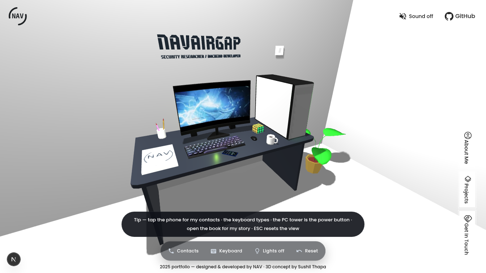

# NAVAIRGAP — 3D Interactive Portfolio

**Live demo → https://3d-portfolio-nav-8975.vercel.app**



An interactive, photorealistic 3D portfolio that runs entirely in the browser. Explore a security researcher's room — open the notebook on the desk to read my story, walk the project wall, answer the phone for contacts, watch the RGB keyboard type, spin the Rubik's cube, and power the PC on and off.

Built with **Next.js + Three.js**. No UI framework, no game engine — one imperative Three.js scene plus hand-written HUD styles.

## Highlights

- **Fully interactive 3D room** — desk setup, honeycomb wall, plants, PC tower, phone, notebook, and a Rubik's cube, all with hover tooltips and click choreography
- **Day / Night themes** — the light switch actually works: LED strips, neon honeycomb, screen glow, and the whole mood of the scene follow it
- **Procedural everything** — keycaps, honeycomb wall, carpet, floor, book pages, and project posters are drawn in code (canvas + geometry), so there are almost no bitmap assets to load
- **PBR materials + HDRI environment lighting** with soft shadows and a monitor light that spills onto the desk
- **Cinematic post-processing** — SSAO, bloom, depth of field, and film grain, with an adaptive quality guard that degrades gracefully on weaker GPUs
- **Performance-first** — Draco-compressed geometry, KTX2 GPU-native textures, LODs on the plant and PC tower, DPR capped per device class
- **Subtle sound design** — key clicks, cube clacks, and coffee slurps synthesized live with WebAudio (toggleable)

## Tech Stack

| Layer     | Tech                                                              |
| --------- | ----------------------------------------------------------------- |
| Framework | Next.js 16 (App Router) · React 19 · TypeScript (strict)          |
| 3D        | Three.js 0.149 (pinned) · GSAP · custom SSAO/bloom/DoF/grain chain |
| Styling   | Hand-written CSS (`portfolio.css`) — no CSS framework             |
| Fonts     | Poppins (Google Fonts) · typekit-style JSON for 3D wall text       |
| Assets    | GLB (Draco) · KTX2/Basis · HDRI (RGBE) · MP4                      |

> Three.js is deliberately pinned to 0.149.0. Upgrading means migrating the
> whole color-management layer (`outputEncoding` → `colorSpace`, texture
> encodings, PMREM changes) — noted as future work, not scheduled.

## Getting Started

Requires **Node.js 20+**.

```bash
git clone https://github.com/navairgap/3d-portfolio.git
cd 3d-portfolio
npm install
npm run dev
```

Open **http://localhost:3000**. No environment variables are required — the site runs as-is.

Dependencies are locked via `package-lock.json` — use npm.

## Scripts

| Command         | Description                    |
| --------------- | ------------------------------ |
| `npm run dev`   | Start the dev server (port 3000) |
| `npm run build` | Production build               |
| `npm start`     | Serve the production build     |
| `npm run lint`  | Run ESLint                     |

## Project Structure

```
src/
  app/
    layout.tsx                 # metadata (SEO/OG), Poppins, global CSS import
    page.tsx                   # client entry — dynamic-imports the experience
  components/
    portfolio/
      PortfolioExperience.tsx  # the world: scene, camera choreography,
                               # lights, post-processing, raycasting, HUD
      gamingKeyboard.ts        # procedural 60% ANSI RGB keycaps
      hexaWall.ts              # seamless honeycomb map/normal/emissive
      phoneScreen.ts           # canvas phone UI + link hit-testing
      bookPage.ts              # measured typesetting on canvas
      bookCover.ts             # vector-drawn cover
      projectPosters.ts        # vector-drawn project wall art
      rubiksCube.ts            # procedural 3x3 cube (scramble/solve)
      floor.ts / carpet.ts     # floor skin + LED strips, woven rug
      pbr.ts                   # Sobel normals, roughness, box projection
      sounds.ts                # WebAudio synthesis (keys, cube, coffee)
      portfolio.css            # loader, HUD, fallback, responsive styles
public/
  models/room.glb              # the room (Draco-compressed)
  textures/                    # HDRI, monitor video, KTX2 sample
  fonts/unione.json            # extruded 3D wall text
  draco/  ktx2/                # runtime decoders (decoder files only)
docs/                          # performance & security checklists
.github/workflows/ci.yml       # lint + typecheck + build on every push
```

## How it works

`PortfolioExperience.tsx` owns everything: it creates the renderer imperatively (safe under StrictMode remounts), builds the world once the room GLB decodes, and exposes a small `WorldActions` bridge (`goToAbout`, `goToProjects`, `toggleLights`, …) back to React through a ref. React state is UI-only — loader, HUD toggles, hint chips — and every camera move is sequenced with an invalidation counter so rapid view-switching can never fight itself.

Most of what you see is **drawn in code**: the keyboard legends, the honeycomb wall, the carpet weave, the book's typeset page, and all six project posters are canvas textures generated at load time. `public/` stays small and the art stays editable.

## Performance notes

- Geometry ships Draco-compressed; textures use KTX2/Basis so GPU memory stays bounded.
- An adaptive quality guard watches frame time and drops SSAO → DoF → bloom in that order when the budget slips (mobile skips SSAO/DoF outright).
- LODs on the plant and PC tower keep draw calls flat; dust motes render only when visible.
- Target: 60 fps on integrated graphics. See `docs/performance-regression-checklist.md` before shipping visual changes.

## Deployment

This is **not a static export** — it's a standard Next.js server build:

- `next.config.ts` injects security headers (`X-Frame-Options`, `X-Content-Type-Options`, `Referrer-Policy`, `Permissions-Policy`), which require the Next server (or a host that runs it).
- **Vercel works with zero config** (this repo's deploy target). Any Node host works: `npm run build && npm start`.
- Header expectations and post-deploy checks: `docs/security-response-header-checklist.md`.

## Accessibility

- The page's `<h1>` and story copy are always in the accessibility tree; when WebGL can't run (or the context is lost mid-session), the fallback becomes the visible page with the same content plus project links.
- Room actions have keyboard equivalents in the quick-actions bar; ESC resets the view; the contact dropdown closes with Escape and returns focus.
- `prefers-reduced-motion` is honored in both JS choreography and CSS; focus rings are visible, including Windows High Contrast mode.

## Editing

Room text, project URLs, and poster content are plain strings/data in `src/components/portfolio/` — change, `npm run dev`, ship. The baked lighting only matters if you move the furniture; words are free. If you swap `room.glb`, the interaction anchors are named meshes (`Book`, `Mobile`, `CPU`, `Rubik Cube`, `SwitchBoard`, …) — remap those names in `PortfolioExperience.tsx`.

## Credits

- Room model concept adapted from [sushilthapa98/3d-portfolio](https://github.com/sushilthapa98/3d-portfolio) (credited in the footer)
- HDRI environment map from the [three.js examples](https://threejs.org) collection
- Geometry & texture compression: Google [Draco](https://github.com/google/draco) and Binomial [Basis Universal](https://github.com/BinomialLLC/basis_universal) — runtime decoders bundled under `public/`
- Built with [Three.js](https://threejs.org), [Next.js](https://nextjs.org), and [GSAP](https://gsap.com)

## License

[MIT](LICENSE) © NAV (navairgap)
